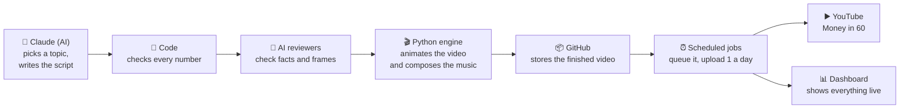

# 1. The big picture

*Plain language. No code knowledge needed.*

## What it is

**Finance Shorts Bot** is a robot video studio. Every day it makes short (30–45 second) vertical
videos that explain one personal-finance idea for an Indian audience, things like *"What does a
₹120 daily chai habit cost over 20 years?"* or *"Is an FD really the safest place for ₹5 lakh?"*.
It publishes one of them a day to the YouTube channel **Money in 60**.

There is **no voiceover**. Big on-screen text, animated characters, charts, music and sound
effects tell the story, so the videos work with the sound off, the way most people scroll Shorts.

## How it works, in one picture

1. **An AI plans and writes the video.** Every night, a Claude session wakes up in the cloud,
   looks at what has been made recently, picks a fresh topic and a matching animation template,
   and writes a script.
2. **Code checks the maths.** The AI only provides the *inputs* (for example ₹10,000 a month for
   20 years at 12%). Code calculates every result shown on screen, so the numbers can't be wrong
   or made up.
3. **Separate reviewers check the work.** A second AI, which never saw the writer's reasoning,
   checks the facts (Indian tax rules, product names, no promises of returns). After rendering, a
   third AI looks at the actual frames for overlapping text, cut-off words or anything unreadable.
4. **The engine makes the video.** My own Python animation engine draws every frame, moves the
   characters and charts, composes original music and sound effects in code, and encodes an MP4.
5. **It ships to a queue.** The finished video is stored on GitHub, then added to a database queue
   within about a minute.
6. **Two uploads a day.** A scheduled job uploads the next videos in line to YouTube, set to go
   public at 12:37 and 19:07 IST.
7. **The dashboard shows it all.** A password-protected website shows the queue, a calendar, every
   run, every video and live view counts.

## The rules that make it work

| Rule | Why |
|---|---|
| Every number on screen is computed by code | AI can make arithmetic mistakes; code doesn't. Finance content must be right. |
| Every video is different | YouTube demonetises "repetitive, mass-produced" content. Templates, topics, colours, music, opening hooks and title wording all rotate by rule. |
| No voiceover, no downloaded music | All audio is synthesized in code, so there are no copyright claims. |
| Every video ends with "Illustrative only. Not financial advice." | It's education, not advice. |
| Two uploads a day | A steady cadence at the two daily peaks; well inside YouTube's API limits. |
| At most 30 ready videos | When the backlog is full, the AI builds or improves templates instead of making videos. |

## Key numbers

| | |
|---|---|
| Video length | Shorts 30–45 s (a 48–60 s story at 1.35×), 1080×1920; long-form 4–6 min, 1920×1080 |
| Videos made per day | target **3** (five scheduled runs, so a failed run gets made up) |
| Videos published per day | **2**, at 12:37 and 19:07 IST |
| Backlog cap | 30 ready videos (about a month of uploads) |
| Animation templates | 4 today (quiz countdown, myth vs fact, two friends race, money leak meter), more built automatically up to a limit |
| Running cost | a Claude Pro subscription; GitHub, Netlify, Supabase and the YouTube API are on free tiers |

## Where things stand (October 2026)

- The whole pipeline runs unattended: generation, review, render, release, database, upload, stats.
- YouTube's API **audit** is pending. Until Google approves it, videos uploaded through the API are
  locked to private, so for now videos are **uploaded by hand** (download from the dashboard,
  upload in YouTube Studio, click *Mark as uploaded*). After approval, uploads go back to automatic.
