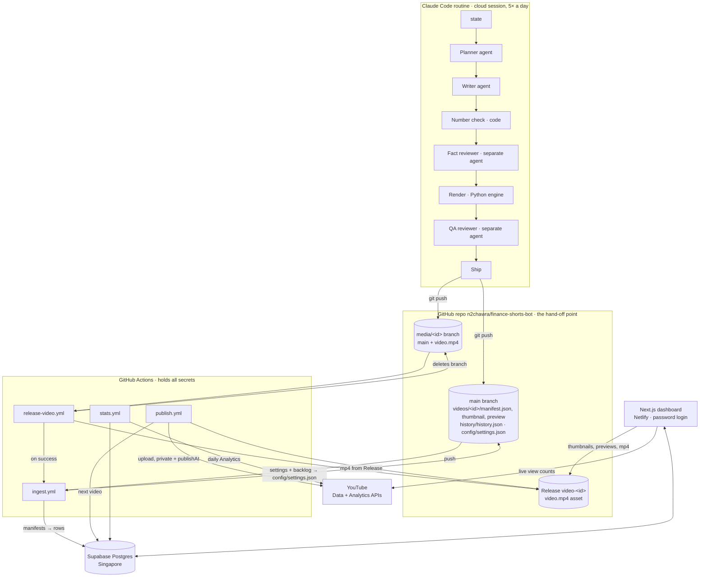

# 2. Architecture

*Technical. How the parts connect, and why it was built this way.*

## The whole system



## The four parts

| Part | Where it runs | Language | What it does |
|---|---|---|---|
| **Routine** (`generator/`, prompts) | Claude Code cloud session on a schedule | Python + prompts | Plans, writes, checks, renders and ships one video (or builds a template) |
| **Renderer** (`renderer/`) | Inside the routine session | Python 3.12, Pillow, NumPy, SciPy, ffmpeg | Turns a script JSON into frames, synthesized audio and an MP4 |
| **Workers** (`workers/`, `.github/workflows/`) | GitHub Actions | TypeScript (Node 22), Prisma | Release, ingest, publish, stats: everything that needs a secret |
| **Dashboard** (`apps/dashboard/`) | Netlify (Next.js runtime) | TypeScript, Next.js 15, React 19 | Shows and controls everything; password protected |

## Key design decisions

### 1. The AI sessions never hold a secret
Routines run in Anthropic's cloud. They get **no** database URL, YouTube token or Telegram token.
Everything they produce goes through **git**, and only GitHub Actions (where the secrets live)
talk to the database and YouTube. If a session misbehaves, the worst it can do is push a bad
commit, and it can't upload or delete anything on the channel.

### 2. GitHub is the hand-off point
The repo is the queue between the AI and the rest of the system. A shipped video is a folder of
small files on `main` plus an MP4 in a GitHub Release. That gives version history, easy
inspection and free storage for large files.

### 3. Why the `media/<id>` branch exists
Cloud sessions are not allowed to create GitHub Releases. So the session pushes a temporary
branch `media/<id>` (the current commit plus `video.mp4`). The `release-video.yml` workflow fires
on that push, creates Release `video-<id>` with the MP4 as an asset, and deletes the branch. MP4s
never land on `main`.

### 4. Settings flow both ways
You change settings in the dashboard, which writes the `Setting` table. Workers read the database
directly. Routines can't, so every ingest run writes the settings plus the current backlog count
to `config/settings.json` in the repo, and routines read that file.

### 5. Every number is computed, never written
The writer agent puts only *inputs* in the script (amount, rate, years). Templates compute every
displayed figure from those inputs, and `generator/numbers.py` independently recomputes them and
rejects a script that hard-codes a result. Text lines in scripts may not even contain digits;
they use placeholders like `{answer}` that code fills in.

### 6. Separate agents with fresh context
The fact reviewer and QA reviewer are separate sub-agents that only get the video id and their
instruction file. They never see the writer's reasoning, so they don't inherit its blind spots.

### 7. Free tiers first
GitHub Actions, Netlify, Supabase and the YouTube API all run on free tiers; the only paid piece
is the Claude Pro subscription that runs the routines. The worker code is plain Node so it could
move to a small VPS with a job queue if free tiers ever get in the way.

## Repository map

```
apps/dashboard/        Next.js dashboard (pages in src/app, API routes in src/app/api, Prisma schema)
workers/               ingest.ts, publish.ts, stats.ts, auth.ts (one-time YouTube sign-in), lib/
renderer/
  engine/              canvas, easing, camera, characters, props, effects, finance, formatting,
                       music, audio (SFX + mixer), style, video (template base), preview, mux
  templates/<name>/    template.py + schema.json + README.md (one folder per template)
  cli.py               script.json → mp4 + thumbnail + contact sheet
generator/             run.py (the CLI the routine calls), history, variety, numbers, settings
  prompts/             routine.md, planner, writer, fact_reviewer, qa_reviewer, template_builder
videos/<id>/           manifest.json, plan.json, script.json, run.json, render.json, thumbnail.png, preview.png
history/               history.json (every shipped video), template_work.json
config/settings.json   settings + backlog for routines (written by ingest)
examples/              one example script per template
.github/workflows/     release-video, ingest, publish, stats
docs/                  this guide, the public site (privacy/terms), channel art and audit material
```

## Security in one table

| Asset | Who can touch it | Protection |
|---|---|---|
| Database URL, YouTube OAuth tokens | GitHub Actions only (repo secrets) | Never committed, never given to routines |
| Dashboard | You | Password login, HMAC-signed 30-day session cookie, every page and API route checked by middleware; fails closed if no password is configured |
| Dashboard's GitHub token | Netlify (env var) | Fine-grained, read-only, this repo only |
| YouTube API key (live counts) | Netlify (env var) | Read-only public data, restricted to the YouTube Data API |
| Repo | You, the Claude GitHub app, Actions | Private; routines may not touch `apps/`, `workers/`, `.github/`, settings or prompts |
