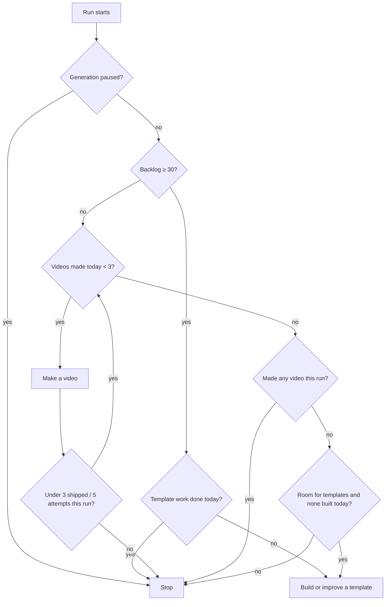

# 3. A day in the life

*What runs when. All times are IST (UTC+5:30). GitHub can start scheduled jobs 5–30 minutes late.*

## The timetable

| Time (IST) | What | Source |
|---|---|---|
| 18:37 | Data audit: dashboard numbers vs YouTube vs database | `data-audit.yml`, cron `7 13 * * *` UTC |
| 23:00 | **Auditor agent**: data bugs, code bugs, one refactor | Claude routine, cron `30 17 * * *` UTC |
| 23:47 | **Research agent**: top Shorts, trends, Claude updates → proposals | Claude routine, cron `17 18 * * *` UTC |
| **04:07** | Main routine run: makes all 3 of the day's videos in one session (fresh usage window) | Claude routine, cron `37 22 * * *` UTC |
| 06:17 | **Improver agent**: judge experiments, start one or wait, manage templates | Claude routine, cron `47 0 * * *` UTC |
| 07:37 | **Dashboard agent**: bug hunt, one fix or improvement | Claude routine, cron `7 2 * * *` UTC |
| 09:07 | Spare video run: makes up any missing videos (fresh usage window) | Claude routine, cron `37 3 * * *` UTC |
| 09:37 | **Scout agent**: finds long-video topics, studies long-form craft | Claude routine, cron `7 4 * * *` UTC |
| 11:30 | **Midday trend run**: a few searches for a money trend people are talking about today; at most one extra Short, which jumps the queue for 19:07 (`generator/prompts/trend_run.md`) | Claude routine, cron `0 6 * * *` UTC |
| 14:37 (Mon/Wed/Fri) | **Studio agent**: makes one long video end to end, with its thumbnail | Claude routine, cron `7 9 * * 1,3,5` UTC |
| 20:07 (Tue/Thu/Sat) | A long video goes public | `publish.yml` |
| every hour (:13) | Watchdog: raises owner notifications, resolves fixed ones | `watchdog.yml` |
| 05:53 | Ingest (safety net) | `ingest.yml`, cron `23 */6 * * *` UTC |
| 08:47, then every 3 h | Stats: YouTube Analytics daily numbers → database | `stats.yml`, cron `17 */3 * * *` UTC |
| **10:07** | Publish: uploads two videos, private, with `publishAt` 12:37 and 19:07 today | `publish.yml`, cron `37 4,7,10 * * *` UTC |
| 11:53 | Ingest (safety net) | `ingest.yml` |
| **12:37** | YouTube makes the first video public | YouTube |
| 13:07 | Publish retry (only if a slot is still empty) | `publish.yml` |
| 16:07 | Publish retry | `publish.yml` |
| 17:53 | Ingest (safety net) | `ingest.yml` |
| **19:07** | YouTube makes the second video public | YouTube |
| 23:53 | Ingest (safety net) | `ingest.yml` |

Event-driven jobs also run whenever something happens:

| Trigger | Job | Delay |
|---|---|---|
| A routine pushes `media/<id>` | `release-video.yml` creates Release `video-<id>`, deletes the branch | ~20 s |
| Release workflow finishes | `ingest.yml` adds the video to the database as `queued` | ~1 min |
| Any push to `main` touching `videos/`, `history/`, `renderer/templates/` or the Prisma schema | `ingest.yml` (shows failed videos and template runs, applies migrations) | ~1 min |
| Dashboard page open | refreshes every 30 s; reads live view counts from YouTube at most once a minute | live |

## Why one run makes all three videos

Every routine session spends part of its effort on setup: cloning, installing, reading the
instructions. Making the day's three videos in **one** session pays that cost once instead of
three times. Inside the run, each video still gets its own fresh fact-review and QA agents.

The run loops: after each video it asks `state` again and keeps going while fewer than 3 were
made today (at most 3 shipped and 5 attempts per run). The **09:07 spare run** covers a main run
that failed or hit the Pro plan's usage limit; on a normal day it ends within a minute. Template
work is now the improver agent's job ([page 11](11-self-improving-agents.md)).

## A normal day in numbers

- 3 videos made → backlog +3
- 2 videos uploaded → backlog −2
- Net backlog growth ≈ +1 a day until it reaches 30, then generation switches to template work
  only, until uploads bring the backlog back below 30.
