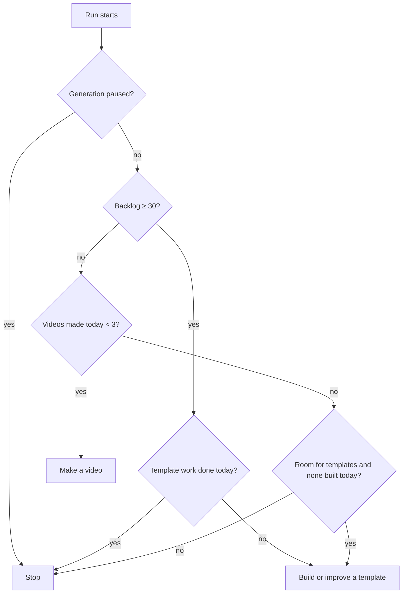

# 3. A day in the life

*What runs when. All times are IST (UTC+5:30). GitHub can start scheduled jobs 5–30 minutes late.*

## The timetable

| Time (IST) | What | Source |
|---|---|---|
| **01:07** | Routine run 1: makes video 1 of 3 | Claude routine, cron `37 1,8,15,19,22 * * *` UTC |
| **04:07** | Routine run 2: makes video 2 of 3 | same |
| 05:53 | Ingest (safety net) | `ingest.yml`, cron `23 */6 * * *` UTC |
| **07:07** | Routine run 3: makes video 3 of 3 | same |
| 08:47, then every 3 h | Stats: YouTube Analytics daily numbers → database | `stats.yml`, cron `17 */3 * * *` UTC |
| **10:07** | Publish: uploads the next video, private with `publishAt` = today 19:07 | `publish.yml`, cron `37 4,7,10 * * *` UTC |
| 11:53 | Ingest (safety net) | `ingest.yml` |
| 13:07 | Publish retry (only if 10:07 failed) | `publish.yml` |
| **14:07** | Routine run 4: make-up run if fewer than 3 were made, otherwise one template-work run | Claude routine |
| 16:07 | Publish retry | `publish.yml` |
| 17:53 | Ingest (safety net) | `ingest.yml` |
| **19:07** | YouTube makes the day's video public (set by `publishAt`) | YouTube |
| **21:07** | Routine run 5: make-up or idle | Claude routine |
| 23:53 | Ingest (safety net) | `ingest.yml` |

Event-driven jobs also run whenever something happens:

| Trigger | Job | Delay |
|---|---|---|
| A routine pushes `media/<id>` | `release-video.yml` creates Release `video-<id>`, deletes the branch | ~20 s |
| Release workflow finishes | `ingest.yml` adds the video to the database as `queued` | ~1 min |
| Any push to `main` touching `videos/`, `history/`, `renderer/templates/` or the Prisma schema | `ingest.yml` (shows failed videos and template runs, applies migrations) | ~1 min |
| Dashboard page open | refreshes every 30 s; reads live view counts from YouTube at most once a minute | live |

## Why five runs for three videos

Each run checks how many videos were made today. While that's under the **daily target of 3**,
the run makes a video. Once 3 are made, the next run does one template-work run, and any run
after that ends within a minute. So the 14:07 and 21:07 runs are **spares**: on a normal day
they don't make videos, but if an earlier run failed or hit the Pro plan's usage limit, they make
the missing ones.

The night slots (01:07, 04:07, 07:07) were chosen so generation happens while you're not using
Claude yourself; runs are spaced so no single 5-hour usage window carries all three.

## A normal day in numbers

- 3 videos made → backlog +3
- 1 video uploaded → backlog −1
- Net backlog growth ≈ +2 a day until it reaches 30 (about two weeks), then generation switches to
  template work only, until uploads bring the backlog back below 30.
