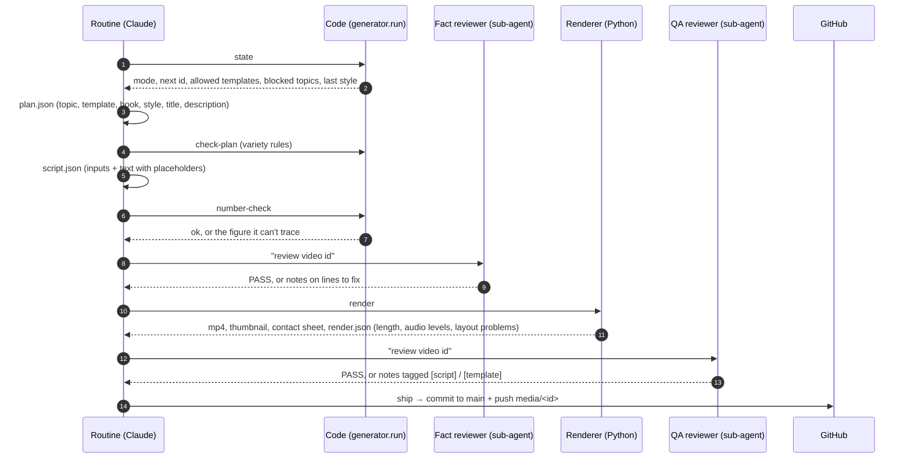
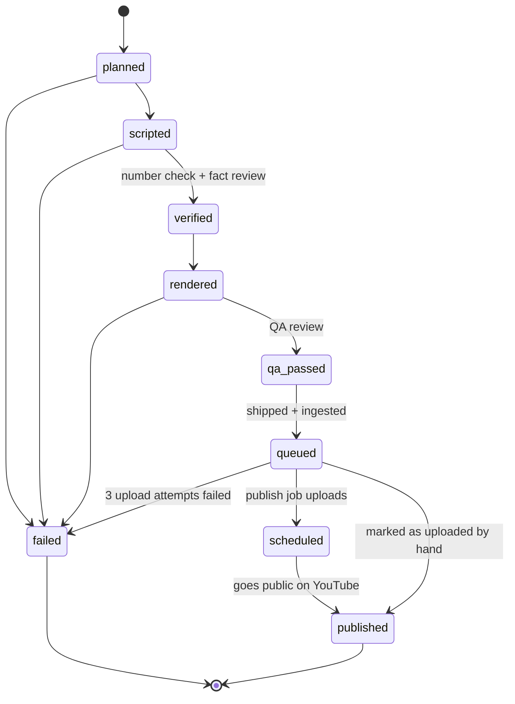

# 4. How a video is made

*One generation run, step by step. The routine follows [`generator/prompts/routine.md`](../../generator/prompts/routine.md);
the code steps are `python -m generator.run <command>` ([`generator/run.py`](../../generator/run.py)).*

## The nine steps

| # | Step | Who | What happens | Fails when |
|---|---|---|---|---|
| 1 | **State** | code | Reads `history/history.json` and `config/settings.json`, decides the mode (video / template work / idle / paused) and lists what the planner may use | — |
| 2 | **Plan** | Claude | Picks a concrete topic, a template, hook style, palette, music genre/key/tempo, seed, title, description, CTA, hashtags → `plan.json` | `check-plan` finds a variety violation (3 attempts) |
| 3 | **Write** | Claude | Fills the template's `schema.json`: numeric *inputs* (amount, rate, years) and on-screen text with placeholders (`{answer}`, `{invested}`) → `script.json` | schema invalid |
| 4 | **Number check** | code | `generator/numbers.py` recomputes every displayed figure from the inputs with closed-form formulas (SIP future value, lump sum, EMI, FD maturity, inflation-adjusted value) and rejects any number in the title, description or text it can't trace to an input or a computed figure | a hard-coded result or a contradiction (2 rewrites max) |
| 5 | **Fact review** | separate agent, fresh context | Checks Indian context (tax, SIP/FD/PPF/NPS/ELSS rules, SEBI/RBI), realistic assumptions (equity ≤ ~12%, FD ≤ ~8%), misleading framing, advice-like wording ("guaranteed", naming a fund), tone, disclaimer | any of those (2 rewrites max) |
| 6 | **Render** | code | `generator.run render` → MP4 + thumbnail + 8-frame contact sheet + `render.json`. Code also checks length (45–60 s), text size (≥ 44 px), the bottom safe zone, and audio levels | layout problems or length out of range |
| 7 | **QA review** | separate agent, fresh context | Looks at the contact sheet like a phone viewer: overlaps, cut-off text, unreadable contrast, empty scenes, placeholders, labels that disagree with values, missing hook or disclaimer | any of those (3 re-renders max) |
| 8 | **Ship** | code | Writes `manifest.json` (title, description, hashtags, style, checks, every step's log), appends to history, commits and pushes `main`, pushes `media/<id>` with the MP4 | push fails (retried once) |
| 9 | **Release + ingest** | GitHub Actions | Creates Release `video-<id>`, deletes the branch, adds the video to the database as `queued` | — |

## When something fails: self-repair

QA tags each problem with who must fix it:

- **`[script]`**: the run rewrites the named lines, re-runs the number check, gets the fact
  reviewer to re-check the changed lines, renders again.
- **`[template]`**: the template draws something wrong whatever the script says (for example a
  "Year 19" label beside year-20 totals). The run **fixes the template code itself**: smallest
  possible change, only in `renderer/templates/<template>/template.py`, and the renderer test
  suite must pass. If the video then passes QA, the fix is committed with it, so every future
  video benefits.

If a video still can't pass after the limits (3 plans, 2 rewrites, 3 re-renders), the run undoes
any unproven template change, marks the video **failed** (it's committed so you can see why, but
never released), and **starts one more video with a different template**. At most two videos are
attempted per run. The make-up runs later in the day cover anything still missing.

## Variety rules

Enforced in code ([`generator/variety.py`](../../generator/variety.py)), not just requested in
prompts. A plan that breaks one is rejected by `check-plan`.

| Rule | Value |
|---|---|
| Same template not used in the last N videos | N = `min(6, templates − 2)`: 2 with four templates, 6 from eight up |
| Max share of one template in the last 20 videos | 30% (looser while there are fewer than five templates) |
| Same topic category not in the last | 3 videos |
| Near-duplicate topic | blocked for 60 days (word-overlap similarity > 0.6) |
| Title/description opening phrase | not reused from the last 20 videos (first 3 words) |
| Hook style | rotates: question, shock number, myth, challenge; never the same twice in a row |
| Palette, music genre, key, tempo | must differ from the previous video (genres: lo-fi, upbeat pop, cinematic, synthwave, acoustic; 80–120 BPM) |
| Closing call to action | opens differently from the previous one |

## Template work

When the backlog is full, or once a day after the three videos are made (while there are fewer
than the maximum number of templates), a run builds a new template or improves one instead
([`template_builder.md`](../../generator/prompts/template_builder.md)):

1. Decide what's missing: a kind of finance story no template can tell, or a visible weakness.
2. Write `template.py` (a subclass of the engine's `Video`), `schema.json`, `README.md`, an
   example script and the number-check function for it.
3. Render **two test videos** and put them through QA.
4. Only then mark it enabled and commit, after the full test suite passes.

## Video status flow

`failed` videos are never uploaded.

## Files a run leaves in `videos/<id>/`

| File | Contents |
|---|---|
| `plan.json` | topic, template, hook, style, title, description, hashtags, seed |
| `script.json` | template inputs and on-screen text |
| `run.json` | every step with status, timestamps and notes (the run log) |
| `render.json` | duration, style, audio peak/mean, layout problems |
| `thumbnail.png`, `preview.png` | the thumbnail frame and the 8-frame contact sheet |
| `manifest.json` | everything above, summarised; what ingest reads |
| `video.mp4` | only on the `media/<id>` branch and in Release `video-<id>`, never on `main` |
