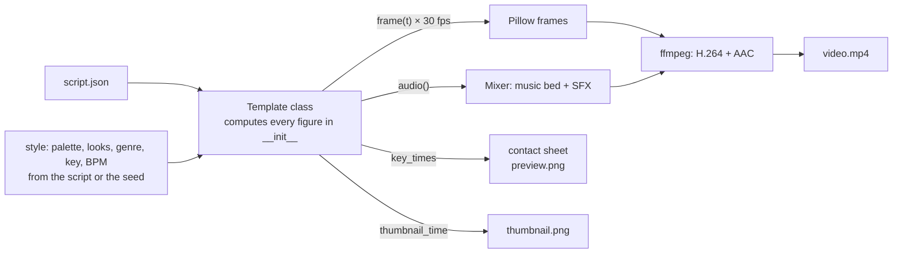

# 5. The renderer

*Technical. How a script JSON becomes an animated, scored MP4, with no video editor, stock footage or
downloaded audio. Code: [`renderer/`](../../renderer).*

## In one sentence

Each template is a Python class that, given the script and a time `t`, **draws one 1080×1920
frame**. The engine calls it 30 times a second for ~50 seconds, synthesizes the soundtrack from
oscillators and noise, and pipes everything into ffmpeg.



## The engine (`renderer/engine/`)

| Module | Responsibility |
|---|---|
| `video.py` | Base class `Video`: style, backdrop, scene dispatch, camera, shared text rules, end scene with the disclaimer, `layout_problems()` |
| `canvas.py` | Drawing surface: frame size, palette, Poppins fonts, text helpers, captions, pills. Safe-area constants: min text 44 px, nothing within 120 px of the bottom |
| `easing.py` | Pure timing helpers: `ease`, `ramp`, `back`, `clamp`, envelopes |
| `camera.py` | Whole-frame effects: slow push-in per scene, impact zoom, shake, flash, progress bar |
| `characters.py` | Simple animated people (skins, hairs, expressions: happy, wow, sad), with looks picked per video |
| `props.py` | Reusable objects: coin, jar, stamp, speech bubble, bar |
| `effects.py` | Background gradient, drifting stars, confetti (seeded, so deterministic) |
| `finance.py` | Money maths templates use: SIP series, lump-sum growth, etc. |
| `formatting.py` | Indian number formatting: ₹1,23,456 · ₹12.4 L · ₹1.2 Cr |
| `music.py` | Five synthesized genres (lo-fi, pop, cinematic, synthwave, acoustic) in any of 12 keys and the genre's tempo range |
| `audio.py` | Stereo mixer and synthesized SFX (pop, whoosh, clink, ding, boom, tick, beep, riser, ka-ching); ducking; levels |
| `style.py` | Resolves the per-video style: 6 palettes (night, forest, plum, ocean, ember, paper), character looks, music settings |
| `preview.py` | Contact sheet of eight key frames for QA, without encoding a video |
| `mux.py` | Pipes raw RGB frames + the WAV into ffmpeg |

## A template

Each folder in `renderer/templates/<name>/` has:

- **`template.py`**: a subclass of `Video`. It sets `duration` (a 48–60 s story timeline; the engine plays it at `TEMPO` 1.35×, so the video lasts 35–45 s), `thumbnail_time` and
  eight `key_times` (the frames QA sees), lists its scenes as `(start, end, draw_fn)`, and marks
  `impacts`, `punches` and `flashes` (the camera reacts to these, giving a pattern interrupt
  every 3–5 s). It implements `audio()`.
- **`schema.json`**: the JSON Schema the writer's script must match.
- **`README.md`**: what the template shows, its inputs and its placeholders. The planner reads
  this to pick a topic that fits.

### The four templates today

| Template | Story it tells |
|---|---|
| `quiz_countdown` | "How much will you have?": three options, a 5-second countdown, the reveal, then money put in vs growth |
| `myth_vs_fact` | A money myth in a speech bubble, stamped MYTH, then FACT with a chart race (e.g. savings account vs inflation) |
| `two_friends_race` | Two people invest the same monthly amount but start at different ages; jars fill, a growth chart races to retirement |
| `money_leak_meter` | A small habit (chai, food delivery) adds up on a meter, then "what if invested?" grows on a chart |

## The rules the engine enforces

| Rule | How |
|---|---|
| Every number is computed | Templates compute figures in `__init__` from inputs; text uses placeholders, and digits in text lines are rejected |
| Readable on a phone | `layout_problems()` measures every drawn text: ≥ 44 px, not within 120 px of the bottom (the Shorts UI), allowing for the camera push-in |
| Hook in the first second | The first scene opens on a big number or question |
| Disclaimer | The base class's end scene always draws "Illustrative only. Not financial advice." |
| Deterministic | Same script + seed → the same frames and sound. Stars, confetti, style picks and noise-based SFX all come from seeded RNGs |
| Audio levels | Master peak about −1 dB, mean about −18 dB; checked in `render.json` |
| Indian formatting | `formatting.py`: ₹, lakh (L) and crore (Cr), Indian digit grouping |

## Commands

```bash
python renderer/cli.py examples/quiz_countdown.json                 # full render → out/
python renderer/cli.py examples/quiz_countdown.json --preview       # thumbnail + contact sheet only
python renderer/cli.py examples/quiz_countdown.json --frames 3 12.8 # single frames, for debugging
python -m pytest renderer generator -q                              # all tests
```

Inside a routine, `python -m generator.run render <id>` wraps the CLI and also checks length and
layout against the settings.
