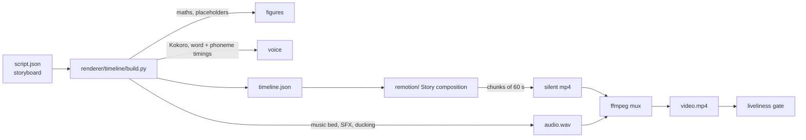

# 5. The renderer

Every video is drawn by **Remotion** (React, `remotion/`). Python owns everything that must be
right: the numbers, the timing and the sound. Remotion only turns a timeline into pixels.



## The script is a storyboard

A script is a list of **beats**. Each beat names a scene (`stage`, `bignumber`, `reveal`,
`statement`, `monster`, `snowball`, `calendar`, `split`, `chart`, `towers`, `checklist`,
`headline`, `chapter`, `end`), the line spoken in it and by whom, named **events** ("when she says
*owes*"), the cast's acting, the camera and the transition. A beat lasts as long as its line, so
the picture always moves with the voice. The full contract: `renderer/templates/long_story/README.md`
and `renderer/templates/short_story/README.md`.

## Numbers

`maths` names the calculations (`sip`, `lumpsum`, `emi`, `card_min_due`); every figure on screen
and in the voice comes from them through `{placeholders}`. Text may not contain a digit or ₹. The
number check recomputes every figure independently in closed form (`generator/numbers.py`). News
videos carry sourced `facts`, copied unchanged from the research feed, shown with their source.

## Pace

Each format plays faster than its story clock (`TEMPOS`): Shorts 1.3×, long videos 1.5×. The voice
is spoken at that speed and Remotion runs every scene's animation on the story clock, so voice,
pauses, animation, camera and transitions speed up together.

## The cast

Rohan, Priya, Sharma and Sikka the coin (`remotion/src/cast/`): a jointed rig with two-bone IK
arms, a distance-driven walk, 11 expressions, blinks and lip-sync from Kokoro's phoneme timings.

## Checks

- `check_script`: everything a build would reject, without speaking anything.
- Liveliness (`renderer/gates.py`) on the finished mp4: median frame change ≥ 1.2, under 15% still
  samples, no 4-second stretch with nothing moving.
- Audio: peak about −1 dB, mean about −18 dB.

## Commands

```
python -m renderer.timeline.build examples/short_story.json --out out/s [--voice estimate]
python -m renderer.remotion out/s/timeline.json --out out/s [--stills-only]
python -m generator.run render <id>        # inside a generation run
```
