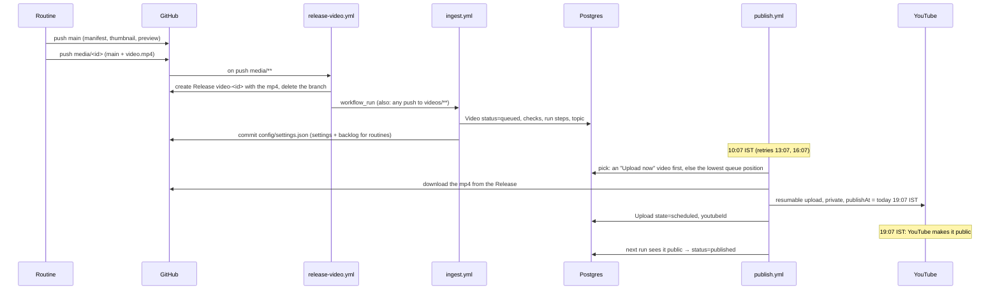

# 6. Publishing and YouTube

*From a shipped video to a public Short, and how views come back. Code: [`workers/`](../../workers),
[`.github/workflows/`](../../.github/workflows).*

## The path of one video

## The publish job ([`workers/publish.ts`](../../workers/publish.ts))

- Runs at 10:07, 13:07 and 16:07 IST. Only the first successful run uploads; the others see
  today's slot is taken and stop. So there's **never more than one upload a day**.
- Order: a video you clicked **Upload now** on goes first; otherwise the top of the queue.
- Uploads **private with `publishAt`** set to the next free slot at the upload time (default
  19:07 IST). YouTube flips it to public at that moment, which is the documented way to schedule.
- Metadata: title, description (ending with the disclaimer), tags; category **Education**;
  *not made for kids*; *no altered or synthetic content* (it's motion graphics, not realistic
  synthetic people).
- A failed upload stays `pending` and is retried on the next run; after **3 attempts** the video
  is marked `failed` with the error.
- Before uploading, it checks scheduled videos whose time has passed: public → `published`; gone
  from YouTube → upload `failed` with "no longer on YouTube".
- If **Pause uploads** is on, it does nothing.

## YouTube API facts that shaped the design

| Fact | Consequence |
|---|---|
| 10,000 quota units a day; an upload costs 1,600 | One upload a day uses 16%; live view counts use ≤ ~1,500 |
| Unverified API projects can only upload **private** videos | The audit is pending; until approved, uploads are by hand (below) |
| OAuth consent screen must be in **Production** | Otherwise refresh tokens expire after 7 days |
| Stored analytics must be refreshed at least every 30 days | The stats job rewrites each video's full history daily; if access is lost for 30 days, stored stats are deleted |

The OAuth app is "Money in 60" with a public homepage, privacy policy and terms at
https://n2chawra.github.io/finance-shorts-site/. Scopes: `youtube.upload`, `youtube.readonly`,
`yt-analytics.readonly`. The refresh token was created once with `npm run auth` in `workers/` and
lives only in GitHub secrets.

## Manual upload mode (until the audit is approved)

While API uploads would stay private, **Pause uploads** is on and you publish by hand:

1. Dashboard → **Queue** → open the top video.
2. **Download**, then upload it in YouTube Studio. Use the copy buttons for the title,
   description (with hashtags) and tags. Pick: not made for kids, Education, altered content No,
   Public.
3. Back on the video page, **Mark as uploaded** and paste the Shorts link.

Marking moves the video from the queue to `published` (whatever state it was in), logs a
`manual_upload` step, and from then on the stats job and live counts track it exactly like a bot
upload. When the audit email arrives, turn Pause uploads off and the bot takes over.

## How numbers come back

| What | Source | Freshness | Where it shows |
|---|---|---|---|
| Views, likes, comments (lifetime) | YouTube Data API public counters, via the dashboard's `YT_API_KEY` | within ~1 minute (refreshed at most once a minute while the dashboard is open) | video page, Overview, Analytics totals, template averages |
| Daily views, likes, comments, subscribers gained, average % viewed | YouTube Analytics API, via `stats.yml` every 3 h | YouTube publishes these 1–2 days late | Analytics charts, video "Views per day", 7-day KPIs |

Totals use whichever is higher: the live counter or the sum of the daily rows. Subscribers and
watch percentage exist only in Analytics. Private videos have no public counters.
