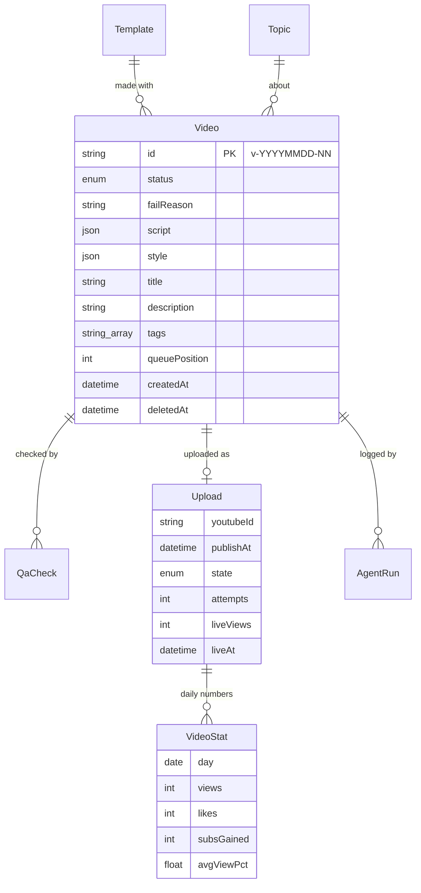

# 8. Data model

*Postgres on Supabase (free tier, Singapore), with the pgvector extension. Schema:
[`apps/dashboard/prisma/schema.prisma`](../../apps/dashboard/prisma/schema.prisma); migrations in
`apps/dashboard/prisma/migrations/`, applied by the ingest workflow (`prisma migrate deploy`).*

The database is a **mirror and control panel**, not the source of truth for generation: routines
can't reach it, and they work from `history/history.json` in the repo. Ingest copies shipped
manifests into the database; the dashboard and workers read and write it.

## Tables

| Table | One row per | Key fields | Written by |
|---|---|---|---|
| `Template` | renderer template | `id` (folder name), `name`, `description`, `version`, `weight`, `enabled`, `lastUsedAt` | ingest (from the folders), dashboard (enable, weight) |
| `Topic` | video topic | `category`, `title`, `embedding` (vector, for near-duplicate search later) | ingest |
| `Video` | video | `id` (`v-YYYYMMDD-NN`), `status`, `failReason`, `script`, `style`, `title`, `description`, `tags`, `queuePosition`, `createdAt`, `deletedAt` (soft delete, so ingest won't re-add it) | ingest, dashboard, publish |
| `QaCheck` | check per video | `checker` (number_check / fact_review / qa_review), `passed`, `notes` | ingest |
| `Upload` | YouTube upload (one per video) | `youtubeId`, `publishAt`, `state` (pending / uploaded / scheduled / published / failed), `error`, `attempts`, `liveViews/Likes/Comments`, `liveAt` | publish, stats, dashboard (manual upload, live counts) |
| `VideoStat` | upload × day | `views`, `likes`, `comments`, `subsGained`, `avgViewPct` | stats |
| `AgentRun` | step of a run | `agent` (planner, number_check, fact_review, render, qa_review, ship, template_builder, manual_upload…), `status`, `log`, `startedAt`, `finishedAt` | ingest (from each manifest), dashboard (manual upload) |
| `Setting` | setting | `key`, `value` (JSON) | dashboard; read by workers; mirrored to `config/settings.json` |

## Video status

`planned → scripted → verified → rendered → qa_passed → queued → scheduled → published`, and any
step can go to `failed` with a reason. In the database you mostly see the last four: a video
arrives as `queued` (or `failed`), the publisher makes it `scheduled`, and it becomes `published`
when YouTube makes it public or when you mark it as uploaded by hand.

## Settings

| Key | Default | Used by |
|---|---|---|
| `uploadTimes` | `12:37`, `19:07` (IST): one upload per time | publish, dashboard |
| `backlogCap` | 30 | routines (via the settings file) |
| `lengthMinSec` / `lengthMaxSec` | 45 / 60 | render check, QA |
| `disclaimer` | Illustrative only. Not financial advice. | templates, YouTube description |
| `uploadsPaused` | false (on while uploading by hand) | publish |
| `generationPaused` | false | routines |
| `templateWork` | `maxPerDay` 1, `maxTemplates` 8–10, `everyNthRun` | routines |
| `alerts` | failed run, failed upload, token errors, low backlog (< 5) | the Telegram watchdog (planned) |
| `statsRefreshedAt` | (internal) | stats: the 30-day stale-data rule |

The routines' daily target (`dailyVideoTarget`, 3) lives in the generator's defaults
([`generator/settings.py`](../../generator/settings.py)).
