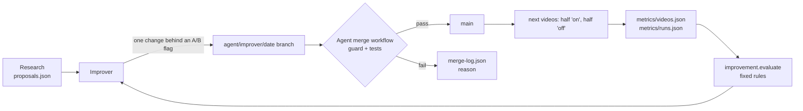

# 11. Self-improving agents

*The automation improves itself. Three agents run every night while the owner sleeps, change the
pipeline only when evidence supports it, and report everything on the dashboard. Instructions:
[`agents/`](../../agents); judging code: [`improvement/evaluate.py`](../../improvement/evaluate.py);
guardrails: [`scripts/guard.py`](../../scripts/guard.py).*

## The night shift (IST)

| Time | Who | What |
|---|---|---|
| 00:07 | **Research** | Studies 3–5 top Shorts (hooks, motion, text, colour, sound, endings), the day's topic, and Claude/Claude Code updates. Writes a report and ranked proposals. Never changes code. |
| 01:07 | Video run | Makes the day's 3 videos (unchanged) |
| 05:17 | **Improver** | Runs the evaluator, closes matured experiments (keep or revert), fixes recurring failures, manages templates, and starts at most one new experiment, or decides to wait |
| 06:47 | **Dashboard** | Bug hunt every night (build, lint, smoke tests, screenshots); UI/UX trend research Mon/Wed/Fri; at most one fix or improvement |
| 08:37 | Spare video run | Makes up any missing videos |

## How a change happens

1. **Proposals, not code.** Research writes what to try and why, with sources.
2. **One change at a time, behind a flag.** The improver implements the best proposal so it applies
   to about half of new videos (chosen by video id), leaving the rest unchanged.
3. **The guard decides what may merge.** Agents can only push `agent/<name>/<date>` branches. The
   `Agent merge` workflow merges only when `scripts/guard.py` passes (allowed files only; the hard
   rules intact: disclaimer, 44 px text, safe zone, numbers checked by code, no audio files or
   network in the renderer, no secrets; size and daily limits) **and** all tests pass.
4. **Wait for data.** An experiment is judged once each group has 8 videos with 48-hour numbers
   (about 8 days at two uploads a day), or after 14 days.
5. **Numbers decide.** `improvement.evaluate` compares the groups: **keep** at +10% views with 80%
   confidence and no rise in QA failures; **revert** at −10%, or if QA failures go up; otherwise
   extend once, then abandon. The improver applies the verdict exactly.

## Templates follow the numbers

- Weights (how often the planner picks a template) follow performance once a template has 6
  videos with data, clamped between 0.4 and 2.0 so every template keeps being tested.
- A template with 10+ videos that is clearly worse than the rest (80% confidence, under 0.75× the
  median) is retired (disabled, kept in the repo).
- New templates are built when fewer than 6 are enabled or research finds a new format: two test
  renders plus QA first, then they start at weight 0.5.
- The improver writes these decisions to `improvement/template-decisions.json`; ingest applies each
  one to the database once.

## What the owner sees

- **Agents page**: one card per agent per night: what it did, what it found (with sources), whether
  it changed something or waited and **why**, and when it will check again. Tabs for experiments
  (with results), proposals and the merge log.
- **Notifications page** (bell in the top bar): only problems the automation can't fix itself, each
  with step-by-step fix instructions. Sources: the hourly watchdog (no videos, empty queue, site
  down, YouTube token, failed GitHub Actions, agents blocked or silent), the workers, the dashboard
  (GitHub token or YouTube API key rejected) and the agents (anything needing the owner, such as a
  Claude model or routine change). Items clear themselves once fixed.
- **Settings → Self-improving agents**: pause all, switch each agent off, and set how many
  experiments may run at once.

## Files

| Path | Written by | Purpose |
|---|---|---|
| `agents/policy.md`, `agents/*.md` | owner | rules and nightly instructions |
| `improvement/research/<date>.md`, `proposals.json`, `seen.json` | research | reports, ideas, Claude versions seen |
| `config/experiments.json` | improver | running A/B flags (read by the generator and renderer) |
| `improvement/experiments.json` | improver | experiment ledger with hypotheses and results |
| `improvement/template-decisions.json` | improver | template weight / retire decisions |
| `improvement/journal.md`, `weekly/` | improver | decision log, Sunday summaries |
| `improvement/dashboard/` | dashboard | bug and idea backlog, nightly reports |
| `improvement/activity/<date>-<agent>.json` | each agent | the Agents page |
| `improvement/notifications/<agent>.json` | each agent | owner-only problems |
| `improvement/merge-log.json` | Agent merge workflow | merged / blocked with reasons |
| `metrics/videos.json`, `metrics/runs.json` | ingest | what the evaluator judges by |
